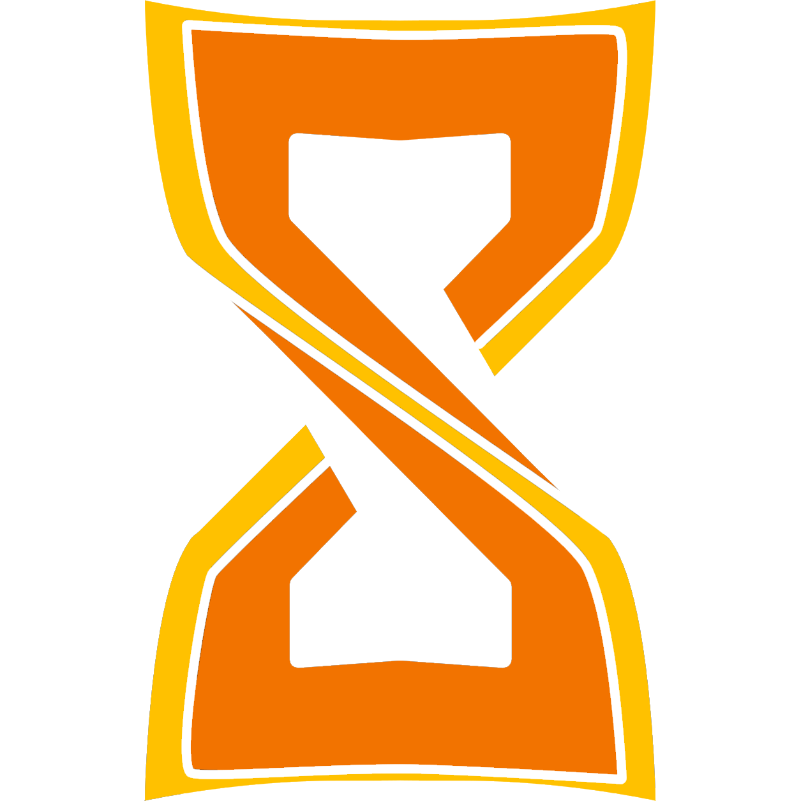
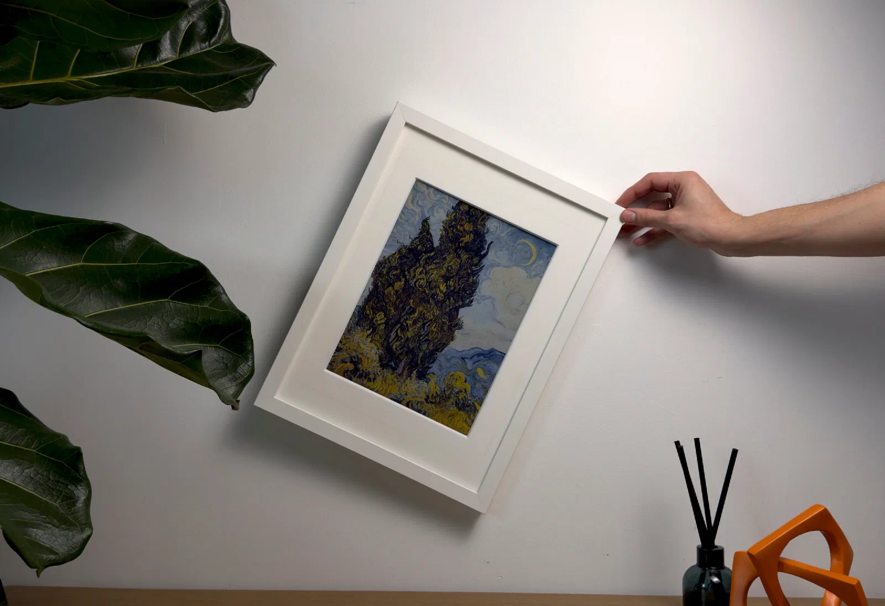
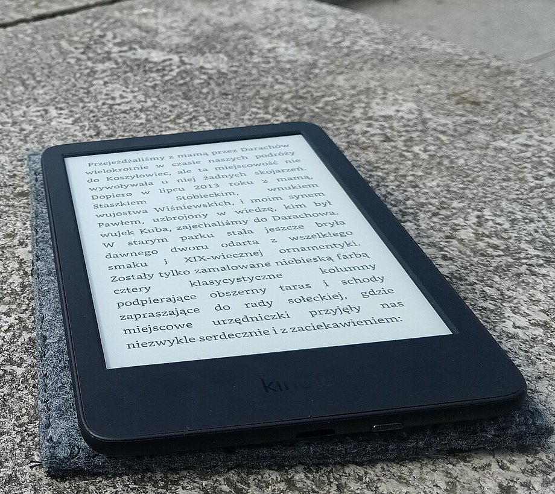
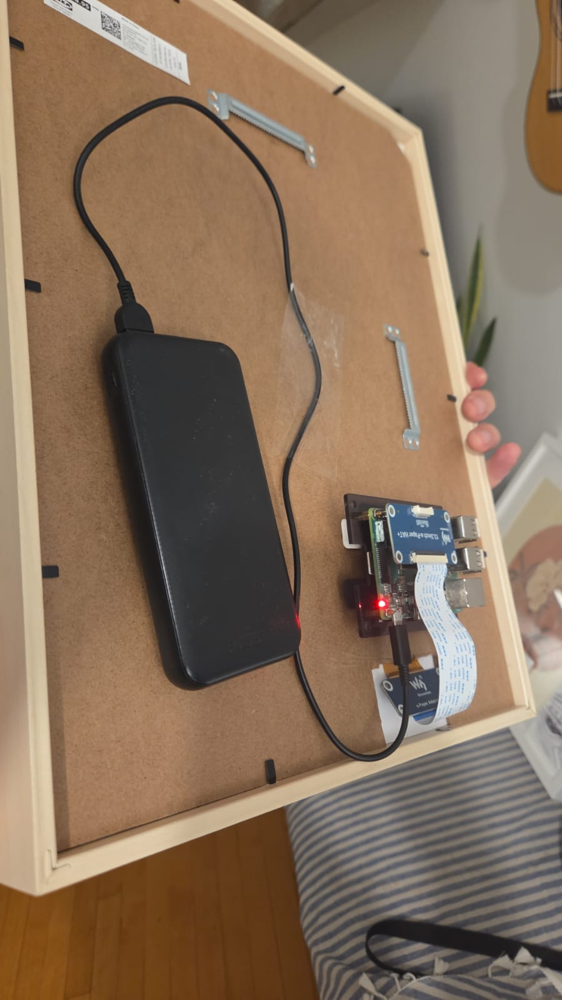
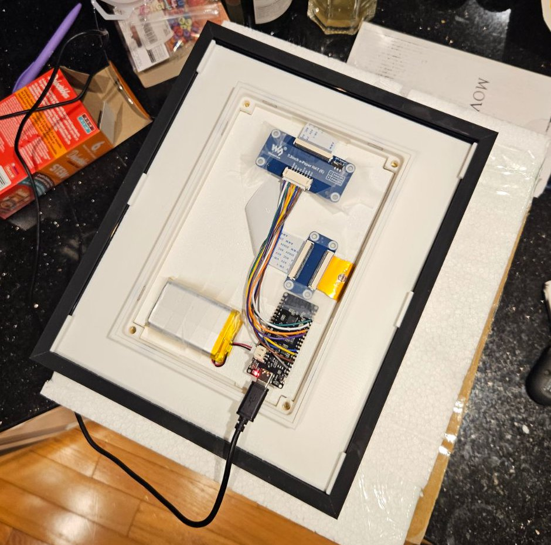
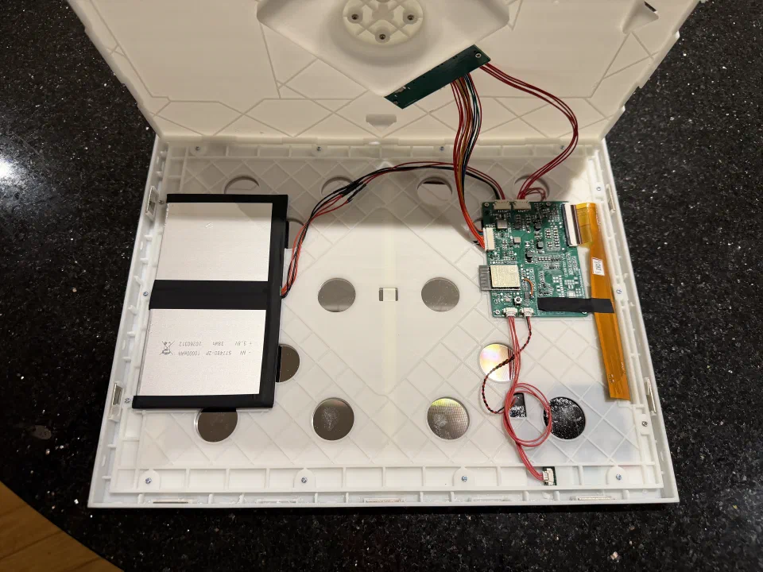
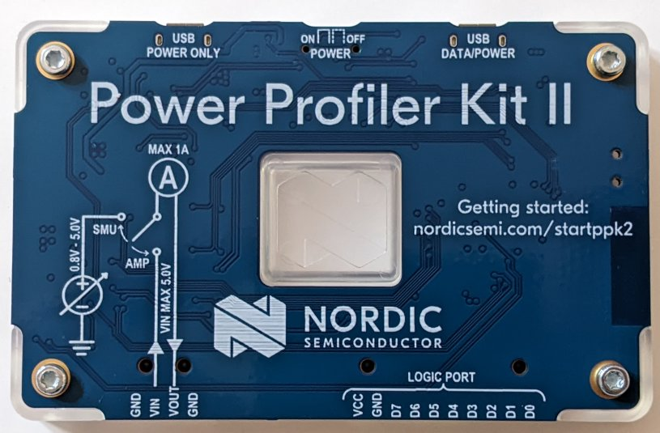
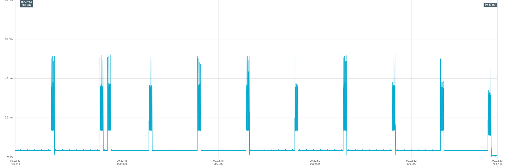
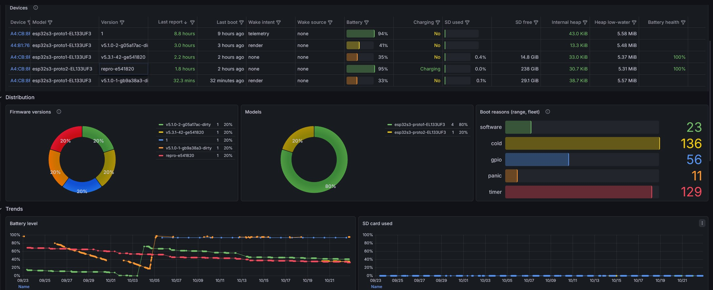
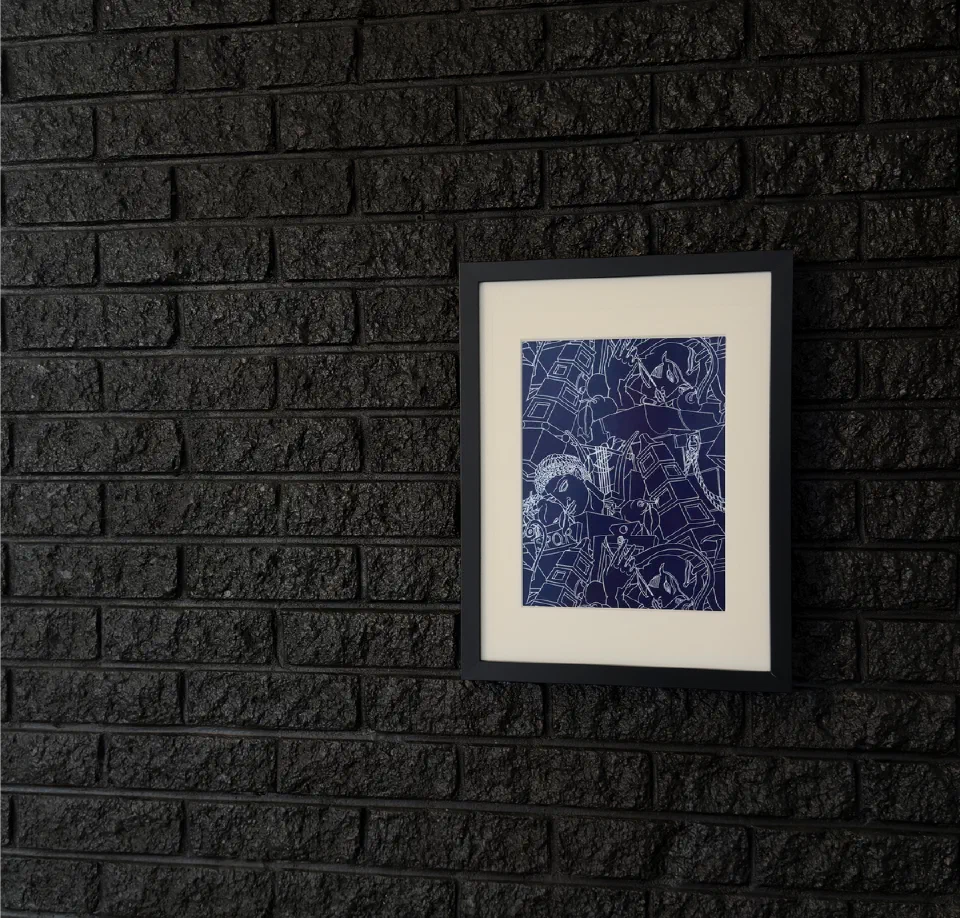

<!-- _class: lead -->
<!-- _paginate: false -->
<!-- _header: Montréal JUG · Présentations éclairs · 5 novembre 2026 -->

# From Backend to Hardware

## D’une idée à un objet fabriqué en série, vu par un développeur backend.

Alexis Couvreur · CTO, Reeveel

<!--
- Ce qui change quand on ne peut plus juste redéployer
-->

---

<!-- _header: Qui suis-je -->

## Alexis Couvreur

<div class="me">
  
  <ul>
    <li><strong>Développeur backend</strong> · Montréal</li>
    <li>Platform engineer · <strong>Banque Nationale</strong></li>
    <li>Cofondateur et CTO · <strong>Reeveel</strong></li>
    <li>Mainteneur · <strong>Sablier</strong></li>
  </ul>
</div>

<!--
- Backend et plateforme : du code déployé en quelques secondes
- Platform engineer à la Banque Nationale : GitHub pour des milliers d'ingénieurs
- Sablier : open source, plus de 3 000 étoiles
- Reeveel depuis 2025 : on fabrique un objet
-->

---

<!-- _class: chapter -->
<!-- _paginate: false -->
<!-- _header: Chapitre 1 / 5 -->

# Le produit

Ce qu’on fabrique, et ce qu’on exige de lui.

---

<!-- _header: Le produit final -->
<!-- _class: reeveel -->



<div class="brand">
  <svg viewBox="0 0 2188 2028" aria-hidden="true"><path fill="currentColor" d="M941.959 22.0852C996.107 6.88575 1052.14 -0.54012 1108.38 0.0305549L1112.2 0.0793831C1763.3 10.2031 1924.92 912.476 1315.46 1147.14L1214.1 1186.16L1557.64 1667.65C1691.12 1854.73 1981.15 1693.42 1892.55 1481.36L2019.76 1428.23L2146.96 1375.11C2362.24 1890.36 1657.54 2282.34 1333.19 1827.75L941.099 1278.22L859.252 1838.88L538.896 1792.14L720.989 544.806L1053.26 509.893L984.776 979.031L1216.41 889.845C1543.33 763.971 1455.83 279.278 1105.54 275.723H1105.54C1075.44 275.417 1045.44 279.393 1016.45 287.531L482.768 437.336C199.295 516.908 209.702 922.256 496.882 987.108L436.11 1256.04C-130.212 1128.16 -150.731 328.806 408.278 171.891L941.959 22.0852Z"/></svg>
  <div>
    <h2>Inkolor</h2>
    <p>par Reeveel</p>
  </div>
</div>

<div class="specs">
  <div><b>Écran</b><span>e-paper couleur, 13,3"</span></div>
  <div><b>Radio</b><span>Bluetooth, Wi-Fi</span></div>
  <div><b>Batterie</b><span>10 000 mAh</span></div>
  <div><b>NFC</b><span>avec le téléphone</span></div>
  <div><b>Capteur</b><span>accéléromètre</span></div>
  <div><b>Bouton</b><span>tactile, caché</span></div>
  <div><b>Stockage</b><span>carte microSD</span></div>
  <div><b>Passe-partout</b><span>aimanté</span></div>
</div>

<!--
- Le résultat final d'abord, le chemin ensuite
- E-paper couleur 13,3", ESP32, Bluetooth et Wi-Fi
- NFC, accéléromètre, bouton caché, microSD, passe-partout aimanté
- Et tout ça sur batterie : c'est ce qui rend le reste difficile
-->

---

<!-- _header: Le produit final -->
<!-- _footer: Photo : WrS.tm.pl, domaine public (Wikimedia Commons) -->



## Le e-paper, comme une liseuse

- Comme un **Kindle**, en couleur
- Pas de rétroéclairage : il **réfléchit** la lumière
- Une image fixe **ne consomme rien**

<!--
- Comme un Kindle, en couleur et en grand
- Réfléchit la lumière : lisible en plein soleil
- Une image fixe ne consomme rien, en changer coûte (on y revient)
-->

---

<!-- _header: Le cahier des charges -->

## Nos exigences

- **Un an** sur une charge
- **Bluetooth** d’abord, Wi-Fi en option
- **Mise à jour** à distance
- **Des périphériques** : NFC, accéléromètre, bouton caché, microSD

<!--
- Un an : dormir presque tout le temps
- Bluetooth, sans compte ni cloud. Le Wi-Fi en option : tout marche sans réseau
- Mise à jour : on livrera des bugs, sans jamais bloquer un cadre
- Périphériques : chacun consomme, chacun peut réveiller le cadre
- De l'idée au Kickstarter : 15 mois
-->

---

<!-- _class: chapter -->
<!-- _paginate: false -->
<!-- _header: Chapitre 2 / 5 -->

# Les prototypes

Du Raspberry Pi à notre propre carte.

---

<!-- _header: L’idée -->



## Raspberry Pi

Python, et un écran e-paper : la preuve que l’image s’affiche.

<!--
- Raspberry Pi et Python : l'écran marche, rien de plus
- Un proof of concept, fait pour être jeté
-->

---

<!-- _header: Prototype 1 -->



## ESP32, fait main

Une puce qui sait dormir profondément.

<!--
- Une ESP32 câblée à la main
- Le vrai critère apparaît : savoir dormir profondément, presque tout le temps
-->

---

<!-- _header: Prototype 3 -->



## Avec notre fabricant

Notre propre carte, dans le boîtier imprimé en 3D, puis usiné en CNC.

<!--
- Boîtier : un cadre du commerce, puis notre imprimante 3D (4 versions en 2 semaines)
- Le fabricant prend le relais : impression 3D, puis usinage CNC
- Sur la photo : la batterie, notre carte, la nappe de l'écran
- Les aimants du passe-partout : premier essai raté, couche trop fine
-->

---

<!-- _class: chapter -->
<!-- _paginate: false -->
<!-- _header: Chapitre 3 / 5 -->

# Le firmware

Organiser un logiciel stateful, en C.

---

<!-- _class: lead -->
<!-- _header: La stack technique -->

# ESP-IDF

## Le framework d’Espressif : bas niveau, en C, au plus près de la puce.

Pas de Linux, pas de processus, pas de garbage collector.

<!--
- Le framework d'Espressif, en C, bas niveau
- Pas de Linux, pas de processus, pas de GC : des tâches, la mémoire à la main
-->

---

<!-- _header: Le firmware -->

## Une journée de dev

<div class="chain loop">
  <div><b>Coder</b><span>en C</span></div>
  <i></i>
  <div><b>Compiler</b><code>make dev-build</code></div>
  <i data-label="USB"></i>
  <div><b>Flasher</b><span>la carte, sur le bureau</span></div>
  <i></i>
  <div><b>Interagir</b><span>l’écran, le bouton, le téléphone</span></div>
</div>

<p class="punch">En backend, on lit un JSON. Ici, on regarde <strong>l’objet réagir</strong>.</p>

<!--
- Backend : coder, relancer, curl, lire un JSON
- Ici : compiler, flasher en USB, regarder l'écran, tourner le cadre, approcher le téléphone
- La console série : on tape une commande, la carte répond
- Un build de dev instrumenté, un build de prod pour mesurer
- [ressenti : voir un objet réagir à son code]
- Transition : comment on organise un vrai logiciel là-dessus ?
-->

---

<!-- _header: Le firmware -->

## Architecturer un firmware

<style scoped>pre { font-size: 19px; line-height: 1.45; }</style>

<pre class="tree"><code>components/features/
├── display/
│   ├── <span class="ctrl">ctrl_ble_display</span>      <i>Bluetooth</i>
│   ├── <span class="ctrl">ctrl_http_display</span>     <i>HTTP</i>
│   ├── <span class="ctrl">ctrl_mqtt_display</span>     <i>MQTT</i>
│   ├── <span class="ctrl">ctrl_cli_display</span>      <i>console</i>
│   ├── <span class="svc">svc_display</span>           <i>le cœur, et sa state machine</i>
│   ├── <span class="drv">drv_epd_el133uf3</span>      <i>l’écran UF3</i>
│   └── <span class="drv">drv_epd_el133uf1</span>      <i>l’écran UF1, une autre variante</i>
└── playlist/
    ├── <span class="ctrl">ctrl_ble_playlist</span>     <i>Bluetooth</i>
    ├── <span class="ctrl">ctrl_http_playlist</span>    <i>HTTP</i>
    ├── <span class="svc">svc_playlist</span>          <i>le cœur</i>
    └── <span class="repo">repo_playlist</span>         <i>les playlists, sur la carte SD</i></code></pre>

<p class="legend">Une feature, un dossier : <span class="ctrl">controllers</span>, <span class="svc">service</span>, <span class="repo">repository</span>, <span class="drv">drivers</span>.</p>

<!--
- La vraie difficulté : un logiciel stateful, l'état vit dans la puce
- Une image peut venir de 5 endroits, parfois en même temps
- On range par feature : un dossier
- Display : 4 controllers, 1 service, 1 driver par écran (UF3, UF1)
- Playlist : un repository sur la carte SD
-->

---

<!-- _header: Le firmware -->

## Le socle : la plateforme

<div class="platform">
  <div class="features"><span>display</span><span>nfc</span><span>playlist</span><span>battery</span><span>ota</span><span>…</span></div>
  <p class="register">chaque feature s’enregistre sur</p>
  <ol>
    <li><b>ble_host</b><span>Bluetooth</span></li>
    <li><b>http_host</b><span>serveur HTTP</span></li>
    <li><b>console_host</b><span>console</span></li>
    <li><b>storage · sdcard</b><span>carte SD</span></li>
    <li><b>power</b><span>énergie</span></li>
  </ol>
</div>

<!--
- Le vertical, les features. L'horizontal, la plateforme
- Configuré une fois : Bluetooth, HTTP, console, carte SD, énergie
- Chaque feature vient s'y enregistrer
- Règle : on n'entre dans la plateforme que quand une 2e feature en a besoin
-->

---

<!-- _header: Le firmware -->

## Features et socle : comment ils se parlent

<svg class="arch" viewBox="0 0 1088 350" role="img" aria-label="Trois features, display, playlist et nfc, au-dessus d’un bus d’événements et de la plateforme. display publie DISPLAYED, storage publie MOUNTED, playlist écoute les deux.">
  <defs><marker id="arch-arrow" viewBox="0 0 10 10" markerWidth="8" markerHeight="8" refX="9" refY="5" orient="auto-start-reverse"><path d="M0,0 L10,5 L0,10 z"/></marker></defs>
  <g class="feature"><rect x="0" y="0" width="340" height="196" rx="10"/><text class="name" x="20" y="28">display/</text>
    <rect class="ctrl" x="16" y="44" width="308" height="40" rx="6"/><text class="ctrl" x="32" y="65">controllers</text>
    <rect class="svc" x="16" y="92" width="308" height="40" rx="6"/><text class="svc" x="32" y="113">svc_display</text>
    <rect class="drv" x="16" y="140" width="308" height="40" rx="6"/><text class="drv" x="32" y="161">drv_epd_el133uf3</text></g>
  <g class="feature"><rect x="374" y="0" width="340" height="196" rx="10"/><text class="name" x="394" y="28">playlist/</text>
    <rect class="ctrl" x="390" y="44" width="308" height="40" rx="6"/><text class="ctrl" x="406" y="65">controllers</text>
    <rect class="svc" x="390" y="92" width="308" height="40" rx="6"/><text class="svc" x="406" y="113">svc_playlist</text>
    <rect class="repo" x="390" y="140" width="308" height="40" rx="6"/><text class="repo" x="406" y="161">repo_playlist</text></g>
  <g class="feature"><rect x="748" y="0" width="340" height="196" rx="10"/><text class="name" x="768" y="28">nfc/</text>
    <rect class="ctrl" x="764" y="44" width="308" height="40" rx="6"/><text class="ctrl" x="780" y="65">controllers</text>
    <rect class="svc" x="764" y="92" width="308" height="40" rx="6"/><text class="svc" x="780" y="113">svc_nfc</text>
    <rect class="drv" x="764" y="140" width="308" height="40" rx="6"/><text class="drv" x="780" y="161">drv_fm11nt083v</text></g>
  <line class="bus" x1="0" y1="240" x2="1088" y2="240"/>
  <text class="bus-label" x="1088" y="230">bus d’événements</text>
  <path class="event" d="M170,198 L170,236"/><text class="event-label" x="182" y="222">DISPLAYED</text>
  <path class="event" d="M544,238 L544,200"/><text class="event-label" x="556" y="222">écoute</text>
  <path class="event" d="M764,298 L764,244"/><text class="event-label" x="776" y="276">MOUNTED</text>
  <text class="platform-label" x="0" y="288">plateforme</text>
  <g class="host"><rect x="0" y="298" width="208" height="48" rx="6"/><text x="104" y="322">ble_host</text></g>
  <g class="host"><rect x="220" y="298" width="208" height="48" rx="6"/><text x="324" y="322">http_host</text></g>
  <g class="host"><rect x="440" y="298" width="208" height="48" rx="6"/><text x="544" y="322">console_host</text></g>
  <g class="host"><rect x="660" y="298" width="208" height="48" rx="6"/><text x="764" y="322">storage · sdcard</text></g>
  <g class="host"><rect x="880" y="298" width="208" height="48" rx="6"/><text x="984" y="322">power</text></g>
</svg>

Dans une feature, les appels descendent. Entre features, **des événements**.

<!--
- Display publie DISPLAYED, la playlist passe à l'image suivante
- Storage publie MOUNTED, le repository retrouve ses fichiers
- Dans une feature : des appels. Entre features : des événements
- Comme un bus de messages, dans la même puce
-->

---

<!-- _header: Le firmware -->

## Comme dans Spring, plus un Driver

<div class="layers">
  <ol>
    <li class="ctrl"><b>Controller</b><span>Bluetooth, HTTP, MQTT, console</span><em>aucune logique</em></li>
    <li class="svc"><b>Service</b><span>les règles métier, la state machine</span></li>
    <li class="repo"><b>Repository</b><span>le stockage : flash, carte SD</span></li>
    <li class="drv"><b>Driver</b><span>la puce, l’écran, les capteurs</span><em>nouveau</em></li>
  </ol>
  <div class="flow">
    <div class="down"><span>appels</span><i></i></div>
    <div class="up"><i></i><span>événements</span></div>
  </div>
</div>

<!--
- Controller, Service, Repository : comme dans Spring
- Plus une couche : le Driver, qui parle au matériel
- Controller sans logique : une règle métier écrite une seule fois
- Les appels descendent, les événements remontent
- Vérifié par le build et un linter, pas en review
-->

---

<!-- _header: Le firmware -->

## Des state machines partout

<svg class="race" viewBox="0 0 1088 380" role="img" aria-label="Un cycle complet : le Bluetooth demande un affichage et passe, HTTP puis la console sont refusés pendant le rendu, puis HTTP redemande et passe.">
  <style>
    /* Only in the HTML deck, where bespoke marks the slide on screen with
       .bespoke-marp-active: the cycle restarts each time the slide is shown.
       Generated, one request at a time over 14 s. */
    svg.bespoke-marp-slide.bespoke-marp-active .race .dot.d1 { animation: race-d1 14.0s linear infinite both; }
    svg.bespoke-marp-slide.bespoke-marp-active .race .dot.d2 { animation: race-d2 14.0s linear infinite both; }
    svg.bespoke-marp-slide.bespoke-marp-active .race .dot.d3 { animation: race-d3 14.0s linear infinite both; }
    svg.bespoke-marp-slide.bespoke-marp-active .race .dot.d4 { animation: race-d4 14.0s linear infinite both; }
    svg.bespoke-marp-slide.bespoke-marp-active .race .wire.ble { animation: race-w-ble 14.0s linear infinite both; }
    svg.bespoke-marp-slide.bespoke-marp-active .race .wire.http { animation: race-w-http-ko 14.0s linear infinite both; }
    svg.bespoke-marp-slide.bespoke-marp-active .race .wire.http2 { animation: race-w-http-ok 14.0s linear infinite both; }
    svg.bespoke-marp-slide.bespoke-marp-active .race .wire.cli { animation: race-w-cli 14.0s linear infinite both; }
    svg.bespoke-marp-slide.bespoke-marp-active .race .v-ble { animation: race-v-ble 14.0s linear infinite both; }
    svg.bespoke-marp-slide.bespoke-marp-active .race .v-http-ko { animation: race-v-http-ko 14.0s linear infinite both; }
    svg.bespoke-marp-slide.bespoke-marp-active .race .v-cli { animation: race-v-cli 14.0s linear infinite both; }
    svg.bespoke-marp-slide.bespoke-marp-active .race .v-http-ok { animation: race-v-http-ok 14.0s linear infinite both; }
    svg.bespoke-marp-slide.bespoke-marp-active .race .st-idle rect { animation: race-s-idle 14.0s linear infinite both; }
    svg.bespoke-marp-slide.bespoke-marp-active .race .st-queued rect { animation: race-s-queued 14.0s linear infinite both; }
    svg.bespoke-marp-slide.bespoke-marp-active .race .st-rendering rect { animation: race-s-rendering 14.0s linear infinite both; }
    svg.bespoke-marp-slide.bespoke-marp-active .race .log0 { animation: race-log0 14.0s linear infinite both; }
    svg.bespoke-marp-slide.bespoke-marp-active .race .log1 { animation: race-log1 14.0s linear infinite both; }
    svg.bespoke-marp-slide.bespoke-marp-active .race .log2 { animation: race-log2 14.0s linear infinite both; }
    svg.bespoke-marp-slide.bespoke-marp-active .race .log3 { animation: race-log3 14.0s linear infinite both; }
    svg.bespoke-marp-slide.bespoke-marp-active .race .log4 { animation: race-log4 14.0s linear infinite both; }
    svg.bespoke-marp-slide.bespoke-marp-active .race .log5 { animation: race-log5 14.0s linear infinite both; }
    svg.bespoke-marp-slide.bespoke-marp-active .race .log6 { animation: race-log6 14.0s linear infinite both; }
    svg.bespoke-marp-slide.bespoke-marp-active .race .log7 { animation: race-log7 14.0s linear infinite both; }
    svg.bespoke-marp-slide.bespoke-marp-active .race .log8 { animation: race-log8 14.0s linear infinite both; }
    @keyframes race-d1 { 0%, 7.13% { transform: translate(0, 0); opacity: 0; } 7.14% { transform: translate(0, 0); opacity: 1; } 14.29% { transform: translate(218px, 102px); opacity: 1; } 15.49%, 100% { transform: translate(218px, 102px); opacity: 0; } } @keyframes race-d2 { 0%, 24.99% { transform: translate(0, 0); opacity: 0; } 25.0% { transform: translate(0, 0); opacity: 1; } 32.14% { transform: translate(218px, 0px); opacity: 1; } 33.34%, 100% { transform: translate(218px, 0px); opacity: 0; } } @keyframes race-d3 { 0%, 39.28% { transform: translate(0, 0); opacity: 0; } 39.29% { transform: translate(0, 0); opacity: 1; } 46.43% { transform: translate(218px, -102px); opacity: 1; } 47.63%, 100% { transform: translate(218px, -102px); opacity: 0; } } @keyframes race-d4 { 0%, 64.28% { transform: translate(0, 0); opacity: 0; } 64.29% { transform: translate(0, 0); opacity: 1; } 71.43% { transform: translate(218px, 0px); opacity: 1; } 72.63%, 100% { transform: translate(218px, 0px); opacity: 0; } } @keyframes race-w-ble { 0% { stroke: #c7cdd4; } 14.28% { stroke: #c7cdd4; } 14.29% { stroke: #1a7f37; } 57.14% { stroke: #1a7f37; } 57.15% { stroke: #c7cdd4; } 100% { stroke: #c7cdd4; } } @keyframes race-w-http-ko { 0% { stroke: #c7cdd4; } 32.13% { stroke: #c7cdd4; } 32.14% { stroke: #d1242f; } 46.43% { stroke: #d1242f; } 46.44% { stroke: #c7cdd4; } 100% { stroke: #c7cdd4; } } @keyframes race-w-http-ok { 0% { stroke: transparent; } 71.42% { stroke: transparent; } 71.43% { stroke: #1a7f37; } 91.43% { stroke: #1a7f37; } 91.44% { stroke: transparent; } 100% { stroke: transparent; } } @keyframes race-w-cli { 0% { stroke: #c7cdd4; } 46.42% { stroke: #c7cdd4; } 46.43% { stroke: #d1242f; } 60.71% { stroke: #d1242f; } 60.72% { stroke: #c7cdd4; } 100% { stroke: #c7cdd4; } } @keyframes race-v-ble { 0% { opacity: 0; } 14.28% { opacity: 0; } 14.29% { opacity: 1; } 57.14% { opacity: 1; } 57.15% { opacity: 0; } 100% { opacity: 0; } } @keyframes race-v-http-ko { 0% { opacity: 0; } 32.13% { opacity: 0; } 32.14% { opacity: 1; } 46.43% { opacity: 1; } 46.44% { opacity: 0; } 100% { opacity: 0; } } @keyframes race-v-cli { 0% { opacity: 0; } 46.42% { opacity: 0; } 46.43% { opacity: 1; } 60.71% { opacity: 1; } 60.72% { opacity: 0; } 100% { opacity: 0; } } @keyframes race-v-http-ok { 0% { opacity: 0; } 71.42% { opacity: 0; } 71.43% { opacity: 1; } 91.43% { opacity: 1; } 91.44% { opacity: 0; } 100% { opacity: 0; } } @keyframes race-s-idle { 0.0% { fill: #eef3fe; stroke: #2563eb; } 14.29% { fill: #eef3fe; stroke: #2563eb; } 14.3% { fill: #f7f8fa; stroke: #e5e7eb; } 57.13% { fill: #f7f8fa; stroke: #e5e7eb; } 57.14% { fill: #eef3fe; stroke: #2563eb; } 71.43% { fill: #eef3fe; stroke: #2563eb; } 71.44% { fill: #f7f8fa; stroke: #e5e7eb; } 91.42% { fill: #f7f8fa; stroke: #e5e7eb; } 91.43% { fill: #eef3fe; stroke: #2563eb; } 100.0% { fill: #eef3fe; stroke: #2563eb; } } @keyframes race-s-queued { 0% { fill: #f7f8fa; stroke: #e5e7eb; } 14.28% { fill: #f7f8fa; stroke: #e5e7eb; } 14.29% { fill: #eef3fe; stroke: #2563eb; } 20.0% { fill: #eef3fe; stroke: #2563eb; } 20.01% { fill: #f7f8fa; stroke: #e5e7eb; } 71.42% { fill: #f7f8fa; stroke: #e5e7eb; } 71.43% { fill: #eef3fe; stroke: #2563eb; } 77.14% { fill: #eef3fe; stroke: #2563eb; } 77.15% { fill: #f7f8fa; stroke: #e5e7eb; } 100% { fill: #f7f8fa; stroke: #e5e7eb; } } @keyframes race-s-rendering { 0% { fill: #f7f8fa; stroke: #e5e7eb; } 19.99% { fill: #f7f8fa; stroke: #e5e7eb; } 20.0% { fill: #eef3fe; stroke: #2563eb; } 57.14% { fill: #eef3fe; stroke: #2563eb; } 57.15% { fill: #f7f8fa; stroke: #e5e7eb; } 77.13% { fill: #f7f8fa; stroke: #e5e7eb; } 77.14% { fill: #eef3fe; stroke: #2563eb; } 91.43% { fill: #eef3fe; stroke: #2563eb; } 91.44% { fill: #f7f8fa; stroke: #e5e7eb; } 100% { fill: #f7f8fa; stroke: #e5e7eb; } } @keyframes race-log0 { 0.0% { opacity: 1; } 14.29% { opacity: 1; } 14.3% { opacity: 0; } 100% { opacity: 0; } } @keyframes race-log1 { 0% { opacity: 0; } 14.28% { opacity: 0; } 14.29% { opacity: 1; } 20.0% { opacity: 1; } 20.01% { opacity: 0; } 100% { opacity: 0; } } @keyframes race-log2 { 0% { opacity: 0; } 19.99% { opacity: 0; } 20.0% { opacity: 1; } 32.14% { opacity: 1; } 32.15% { opacity: 0; } 100% { opacity: 0; } } @keyframes race-log3 { 0% { opacity: 0; } 32.13% { opacity: 0; } 32.14% { opacity: 1; } 46.43% { opacity: 1; } 46.44% { opacity: 0; } 100% { opacity: 0; } } @keyframes race-log4 { 0% { opacity: 0; } 46.42% { opacity: 0; } 46.43% { opacity: 1; } 57.14% { opacity: 1; } 57.15% { opacity: 0; } 100% { opacity: 0; } } @keyframes race-log5 { 0% { opacity: 0; } 57.13% { opacity: 0; } 57.14% { opacity: 1; } 71.43% { opacity: 1; } 71.44% { opacity: 0; } 100% { opacity: 0; } } @keyframes race-log6 { 0% { opacity: 0; } 71.42% { opacity: 0; } 71.43% { opacity: 1; } 77.14% { opacity: 1; } 77.15% { opacity: 0; } 100% { opacity: 0; } } @keyframes race-log7 { 0% { opacity: 0; } 77.13% { opacity: 0; } 77.14% { opacity: 1; } 91.43% { opacity: 1; } 91.44% { opacity: 0; } 100% { opacity: 0; } } @keyframes race-log8 { 0% { opacity: 0; } 91.42% { opacity: 0; } 91.43% { opacity: 1; } 100.0% { opacity: 1; } }
    @media (prefers-reduced-motion: reduce) { svg.bespoke-marp-slide.bespoke-marp-active .race * { animation: none !important; } }
  </style>
  <defs><marker id="race-arrow" viewBox="0 0 10 10" markerWidth="8" markerHeight="8" refX="9" refY="5" orient="auto-start-reverse"><path d="M0,0 L10,5 L0,10 z"/></marker></defs>
  <g class="caller"><rect x="0" y="20" width="200" height="56" rx="8"/><text x="100" y="48">Bluetooth</text></g>
  <g class="caller"><rect x="0" y="130" width="200" height="56" rx="8"/><text x="100" y="158">HTTP</text></g>
  <g class="caller"><rect x="0" y="240" width="200" height="56" rx="8"/><text x="100" y="268">console</text></g>
  <line class="wire ble ok" x1="200" y1="48" x2="418" y2="150"/>
  <line class="wire http ko" x1="200" y1="158" x2="418" y2="158"/>
  <line class="wire http2" x1="200" y1="158" x2="418" y2="158"/>
  <line class="wire cli ko" x1="200" y1="268" x2="418" y2="166"/>
  <circle class="dot d1" cx="200" cy="48" r="9"/>
  <circle class="dot d2" cx="200" cy="158" r="9"/>
  <circle class="dot d3" cx="200" cy="268" r="9"/>
  <circle class="dot d4" cx="200" cy="158" r="9"/>
  <text class="verdict ok v-ble" x="319" y="76" transform="rotate(25.07 319 76)">✓ accepté</text>
  <text class="verdict ko v-http-ko" x="309" y="140">✗ refusé</text>
  <text class="verdict ok v-http-ok hidden" x="309" y="140">✓ accepté</text>
  <text class="verdict ko v-cli" x="319" y="240" transform="rotate(-25.07 319 240)">✗ refusé</text>
  <g class="service"><rect x="420" y="128" width="220" height="60" rx="8"/><text x="530" y="158">svc_display</text></g>
  <line class="link" x1="640" y1="158" x2="796" y2="158"/>
  <text class="link-label" x="718" y="146">fsm_try</text>
  <g class="state st-idle"><rect x="800" y="10" width="200" height="56" rx="8"/><text x="900" y="38">IDLE</text></g>
  <g class="state st-queued"><rect x="800" y="130" width="200" height="56" rx="8"/><text x="900" y="158">QUEUED</text></g>
  <g class="state st-rendering on"><rect x="800" y="250" width="200" height="56" rx="8"/><text x="900" y="278">RENDERING</text></g>
  <path class="step" d="M900,66 L900,126"/>
  <path class="step" d="M900,186 L900,246"/>
  <path class="step" d="M1000,278 C1078,278 1078,38 1004,38"/>
  <rect class="logbar" x="0" y="328" width="1088" height="48" rx="6"/>
  <text class="log log0" x="24" y="352">I SVC_DISPLAY: IDLE, prêt</text>
  <text class="log log1" x="24" y="352">I SVC_DISPLAY: IDLE --show(src=ble)--> QUEUED</text>
  <text class="log log2" x="24" y="352">I SVC_DISPLAY: QUEUED --show(src=ble)--> RENDERING</text>
  <text class="log log3 warn shown" x="24" y="352">W SVC_DISPLAY: show(src=http) rejected: still RENDERING</text>
  <text class="log log4 warn" x="24" y="352">W SVC_DISPLAY: show(src=cli) rejected: still RENDERING</text>
  <text class="log log5" x="24" y="352">I SVC_DISPLAY: RENDERING --ESP_OK(src=ble)--> IDLE</text>
  <text class="log log6" x="24" y="352">I SVC_DISPLAY: IDLE --show(src=http)--> QUEUED</text>
  <text class="log log7" x="24" y="352">I SVC_DISPLAY: QUEUED --show(src=http)--> RENDERING</text>
  <text class="log log8" x="24" y="352">I SVC_DISPLAY: RENDERING --ESP_OK(src=http)--> IDLE</text>
</svg>

<style scoped>pre { font-size: 20px; margin: .45em 0 .35em; padding: .45em .9em; } .race { max-height: 330px; }</style>

```c
if (!fsm_try(&s_fsm, QUEUED, "show", src)) return ESP_ERR_NOT_FINISHED;
```

**20 machines, 67 états.** Combinés : plus de 5 milliards.

<!--
- Avant : un booléen "busy" quelque part, et on devinait
- L'animation : Bluetooth accepté, HTTP et console refusés pendant RENDERING, puis HTTP passe
- Chaque refus est loggé, pas de verrou dans le code métier
- 20 machines, 67 états : 5 milliards de combinaisons, l'explosion combinatoire
- C'est pour ça qu'on éteint et rallume nos appareils
- Chaque machine reste petite, testable seule
-->

---

<!-- _header: Le firmware -->

## Un code, plusieurs cartes

<pre class="boards"><code><span class="f">sdkconfig.defaults</span>                  <i>commun à toutes les cartes</i>
<span class="f">sdkconfig.</span><span class="chip">esp32s3</span>-<span class="rev">proto1</span>.<span class="panel">EL133UF3</span>   <i><span class="chip">puce</span> · <span class="rev">révision</span> · <span class="panel">écran</span></i>
<span class="f">sdkconfig.</span><span class="chip">esp32s3</span>-<span class="rev">proto2</span>.<span class="panel">EL133UF3</span>   <i>+ LED avant, buzzer</i>

<span class="cmd">make dev-build</span> BOARD=<span class="chip">esp32s3</span>-<span class="rev">proto2</span>.<span class="panel">EL133UF3</span></code></pre>

Une carte, <strong>un profil</strong>. Un écran, <strong class="drv">un driver</strong>. Le reste ne bouge pas.

<!--
- Une carte, un profil : la puce, la révision, l'écran
- De proto1 à proto2 : 4 lignes (LED avant, buzzer)
- Un nouvel écran, c'est un nouveau driver. Le reste ne bouge pas
- En backend : un adapter par fournisseur
-->

---

<!-- _class: chapter -->
<!-- _paginate: false -->
<!-- _header: Chapitre 4 / 5 -->

# L’énergie

Tenir un an sur une charge.

---



<!-- _header: Exigence · un an sur une charge -->
<!-- _footer: Photo du PPK2 : Thomas Amberg, CC BY-SA 2.0, recadrée (Wikimedia Commons) -->

## D’abord, mesurer

<style scoped>
  img.curve { display: block; width: 100%; margin: .2em 0 .5em; border: 1px solid var(--border); border-radius: 8px; }
  .stats { display: flex; gap: 32px; margin: 0 0 .5em; }
  .stats div { display: flex; flex-direction: column; }
  .stats b { font-family: 'Space Grotesk', 'Inter', sans-serif; font-size: 40px; font-weight: 600; line-height: 1.1; }
  .stats span { font-size: 18px; color: var(--muted); }
  section p.how { font-size: 22px; color: var(--muted); margin: 0; }
</style>



<div class="stats">
  <div><b>4,23 mA</b><span>en moyenne</span></div>
  <div><b>72 mA</b><span>au pic</span></div>
  <div><b>10 s</b><span>de mesure</span></div>
</div>

<p class="how">Un <strong>Nordic PPK2</strong>, en série avec la batterie, USB débranché.</p>

<!--
- En backend, la latence. Ici, des microampères
- Un multimètre ne suffit pas : un PPK2 en série avec la batterie
- La mesure : 4,23 mA en moyenne, des pics à 72 mA, chacun est un réveil
- De 10 µA à 150 mA : 4 ordres de grandeur sur la même courbe
- USB débranché : il fausse la mesure
-->

---

<!-- _header: Exigence · un an sur une charge -->
<!-- _footer: Puce ESP32-S3 seule, au repos, 3,3 V, 25 °C. Source : datasheet ESP32-S3 v2.2, Espressif. Barres à l’échelle. -->

## Les leviers, un par un

<ol class="ladder">
  <li style="--w: 100%"><b>Sans rien</b><span>CPU à 160 MHz, qui attend</span><i></i><em>27,6 mA</em></li>
  <li style="--w: 47.8261%"><b>+ CPU adaptatif</b><span>descend à 40 MHz</span><i></i><em>13,2 mA</em><small>÷ 2</small></li>
  <li style="--w: 0.8696%"><b>+ Light sleep</b><span>dort entre deux tâches</span><i></i><em>240 µA</em><small>÷ 115</small></li>
  <li style="--w: 0.0254%"><b>+ Deep sleep</b><span>jusqu’au prochain réveil</span><i></i><em>7 µA</em><small>÷ 3 900</small></li>
  <li class="loupe" aria-hidden="true">
    <svg viewBox="0 0 1088 306">
      <defs><clipPath id="ladder-lens"><circle cx="560" cy="233" r="85"/></clipPath></defs>
      <rect class="source" x="242" y="170" width="22" height="126" rx="11"/>
      <line class="link" x1="264" y1="233" x2="475" y2="233"/>
      <circle class="lens" cx="560" cy="233" r="85"/>
      <g clip-path="url(#ladder-lens)">
        <rect class="bar" x="506" y="178" width="100" height="30"/>
        <rect class="bar" x="506" y="258" width="2.9" height="30"/>
      </g>
      <circle class="rim" cx="560" cy="233" r="85"/>
      <text class="factor" x="680" y="238">× 20</text>
    </svg>
  </li>
</ol>

Et pour y rester : des **interruptions** plutôt que du polling, et **un nom** par raison de rester éveillé.

<!--
- Le point de départ : la puce allumée qui attend, réglage par défaut
- Chaque levier s'ajoute au précédent : ÷ 2, puis ÷ 115, puis ÷ 3 900
- Chiffres de la puce seule : la carte, l'écran et la radio ajoutent le reste
- Interruptions : sinon on se réveille pour vérifier les capteurs
- Deep sleep : chaque réveil repart de zéro, le "éteindre et rallumer" gratuit
- 3 niveaux de présence : connecté, éveillé (s'annonce en Bluetooth), endormi (radio coupée)
- Chaque composant qui garde la puce éveillée doit dire pourquoi
- Un rafraîchissement coûte 4 fois plus que prévu : 1 ou 2 images par jour, une décision produit
-->

---

<!-- _class: chapter -->
<!-- _paginate: false -->
<!-- _header: Chapitre 5 / 5 -->

# Les mises à jour

Corriger un cadre déjà installé chez quelqu’un.

---

<!-- _header: Exigence · mise à jour à distance -->

## Mettre à jour : du blue-green dans la puce

<div class="ab">
  <div>
    <b>1 · Télécharger</b>
    <p class="slot run">A · v1<span>actif</span></p>
    <p class="slot write">B · v2<span>écriture</span></p>
  </div>
  <div>
    <b>2 · Redémarrer</b>
    <p class="slot">A · v1<span>en attente</span></p>
    <p class="slot run">B · v2<span>probation</span></p>
  </div>
  <div class="ok">
    <b>3 · Health check OK</b>
    <p class="slot">A · v1<span>secours</span></p>
    <p class="slot run">B · v2<span>actif</span></p>
  </div>
  <div class="ko">
    <b>3 · Échec</b>
    <p class="slot run">A · v1<span>actif</span></p>
    <p class="slot fail">B · v2<span>rejeté</span></p>
  </div>
</div>

Par Bluetooth : **1,9 Mo en 30 s**. Ou **tout seul**, en HTTP.

<!--
- La mise à jour à distance, c'est du blue-green : vous connaissez déjà
- Deux emplacements : on écrit B pendant que A tourne, on redémarre, B en probation
- Échec : retour automatique sur A
- Pas d'orchestrateur : le firmware se valide lui-même
- Deux chemins : le téléphone en Bluetooth, ou le cadre seul en HTTP
-->

---

<!-- _header: Observer la flotte -->

## Télémétrie : débugger **à l’échelle**

<style scoped>
  .chain { margin: .2em 0 .5em; }
  .chain > div { padding: 6px 16px; flex-direction: row; align-items: baseline; gap: 10px; }
  .chain b { font-size: 22px; }
  .chain span { font-size: 17px; }
  img.shot { display: block; max-width: 100%; max-height: 345px; margin: 0 auto .4em; border-radius: 8px; border: 1px solid var(--border); }
  section p.scope { font-size: 22px; margin: 0; text-align: center; color: var(--muted); }
</style>

<div class="chain">
  <div><b>Le cadre</b><span>logs, crashs, métriques</span></div>
  <i data-label="OTel"></i>
  <div><b>Alloy</b><span>retire les données perso</span></div>
  <i></i>
  <div><b>Grafana</b><span>Loki, Prometheus</span></div>
</div>



<p class="scope">Seulement en développement, ou si un client l’active pour qu’on l’aide. <strong>Désactivée</strong> en production.</p>


<!--
- Au bureau, la console série. Chez quelqu'un, impossible
- OpenTelemetry, comme vos services : logs, crashs, métriques
- Notre propre passerelle : pas de clé d'API dans un firmware public
- Seulement en dev, ou si un client l'active pour qu'on l'aide : désactivée en production
- Le dashboard : versions, raisons de réveil, crashs, batterie
- La télémétrie réveille le cadre une fois par jour au plus
- Les versions cohabitent : on débugge plusieurs versions à la fois
-->

---

<!-- _class: chapter -->
<!-- _paginate: false -->
<!-- _header: Conclusion -->

# Et maintenant ?

D’une idée à un Kickstarter, en 15 mois.

<!--
- On a vu le comment. Maintenant, où on en est
-->

---

<!-- _header: Conclusion -->

## Où on en est

<ol class="timeline">
  <li><b>Juil. 2025</b><span>L’idée</span></li>
  <li><b>Août – nov.</b><span>Écran, boîtier, électronique</span></li>
  <li><b>Déc. 2025</b><span>Prototype 1</span></li>
  <li><b>Début 2026</b><span>Prototype 2</span></li>
  <li><b>Mai – juil.</b><span>Prototypes 3 et 4</span></li>
  <li><b>Sept. 2026</b><span>Validation en usine</span></li>
  <li class="now"><b>14 oct. 2026</b><span>Kickstarter</span><em>en cours</em></li>
  <li class="next"><b>Fin nov.</b><span>Derniers tests</span></li>
  <li class="next"><b>Déc. – févr.</b><span>Production</span></li>
  <li class="next"><b>Avr. – mai 2027</b><span>Livraisons</span></li>
</ol>

<!--
- Juillet 2025 : l'idée
- 4 prototypes, les 2 derniers avec le fabricant
- Le Kickstarter est en ligne depuis le 14 octobre
- La suite : tests, production cet hiver, livraisons au printemps
- Pour moi : mettre à jour des cadres chez des gens que je ne connais pas
-->

---

<!-- _class: lead endcard -->
<!-- _paginate: false -->
<!-- _header: Questions ? -->



# Merci !

## Inkolor est sur Kickstarter en ce moment.

[getreeveel.com](https://getreeveel.com) · [Kickstarter](https://www.kickstarter.com/projects/reeveel/inkolor-the-first-paper-like-frame-that-adapts-to-you?ref=9ob6kv) · [alexiscouvreur.fr](https://www.alexiscouvreur.fr)

<!--
- Merci, place aux questions
-->
