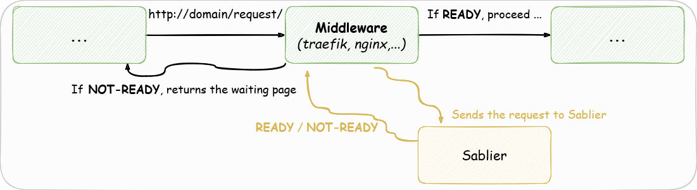
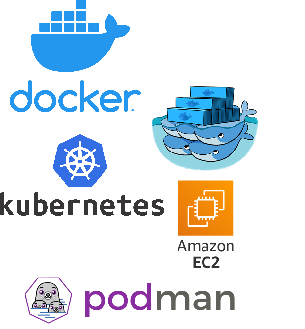
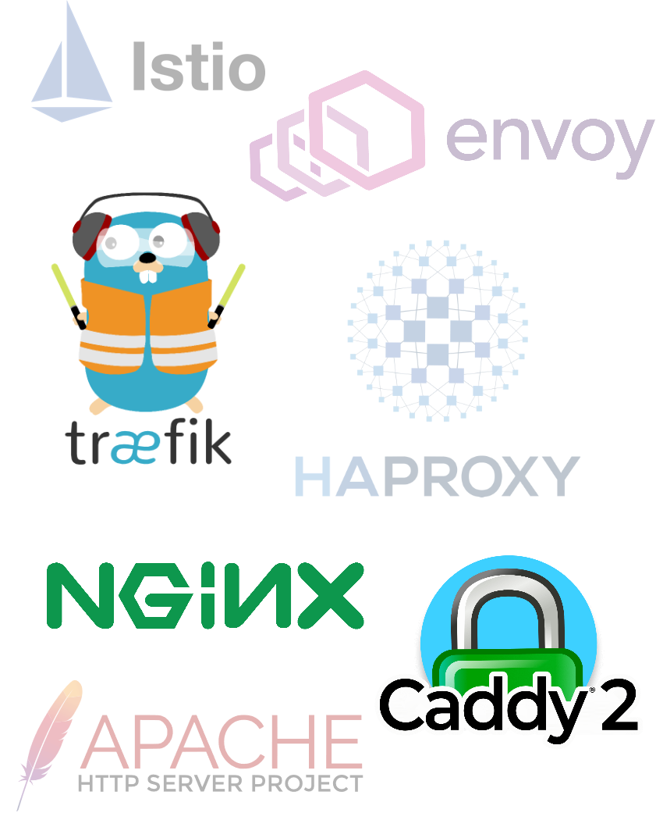
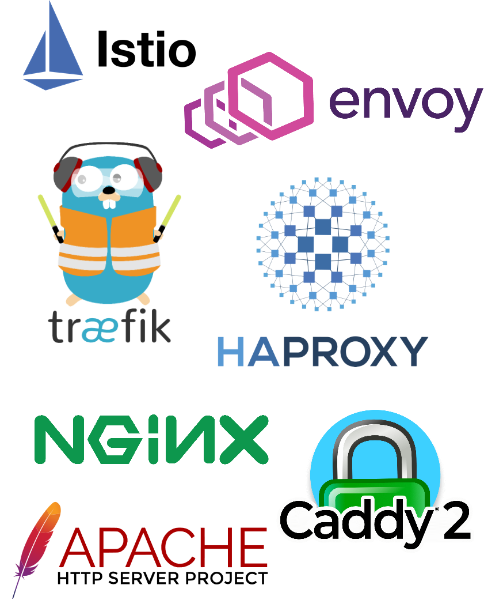
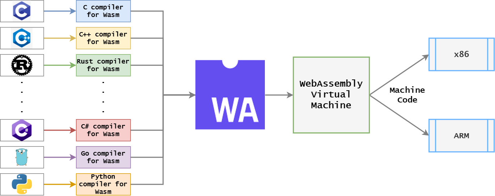
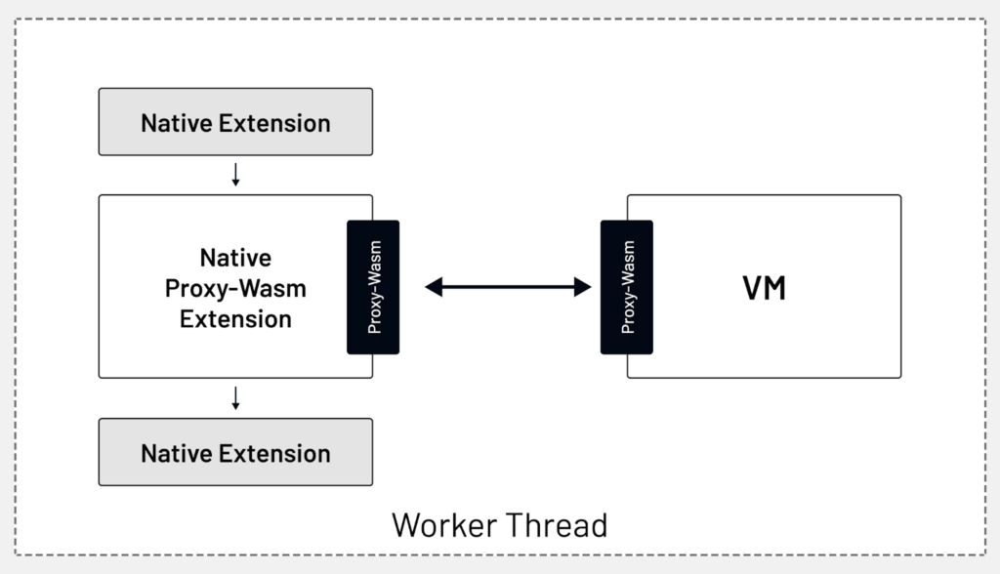

<!-- _class: lead -->
<!-- _paginate: false -->
<!-- _header: Montréal JUG · Lightning Présentations Éclairs, épisode 2 · 29 mars 2023 -->


# Sablier

## Scale to zero

[github.com/sablierapp/sablier](https://github.com/sablierapp/sablier)

---

<!-- _class: lead -->

# Alexis Couvreur

## Fullstack Software Engineer

Working at the National Bank of Canada for SII Canada

---

<!-- _class: lead statement -->

# Reducing infrastructure costs boils down to turning apps off when you don’t use them

---

<!-- _class: lead -->

# Scaling to zero

## Scaling to zero allows workloads to be run only when there is demand

---

## They scale to zero

<div class="split">

- Google Serverless (App Engine, Function)
- AWS Lambda
- Heroku
- Github Codespace
- And more!


</div>

---

<!-- _class: chapter -->

# <span class="sablier">Sablier</span>

A free and open source software scaling to zero solution

---

<!-- _class: chapter -->

# How does it work?

---

## Reverse proxy integration



---

<!-- _class: chapter -->

# How to use <span class="sablier">Sablier</span>?

Let’s see its integration with Caddy!

---

<!-- _class: code -->

## Without Sablier

<div class="split top">
<div>

### docker-compose.yaml

```yaml
services:
  proxy:
    image: caddy:2.6.4
    ports:
      - "8080:80"
    volumes:
      - ./Caddyfile:/etc/caddy/Caddyfile:ro

  whoami:
    image: traefik/whoami:v1.12.0
```

</div>
<div>

### Caddyfile

```nginx
:80 {
  route /whoami {
    reverse_proxy whoami:80
  }
}
```

</div>
</div>

---

<!-- _class: code -->

## With Sablier

<div class="split top">
<div>

### docker-compose.yaml

```yaml
services:
  proxy:
    image: caddy:local
    ports:
      - "8080:80"
    volumes:
      - ./Caddyfile:/etc/caddy/Caddyfile:ro

  whoami:
    image: traefik/whoami:v1.12.0
    labels:
      - sablier.enable=true
      - sablier.group=demo

  sablier:
    image: sablierapp/sablier:1.19.1
    volumes:
      - '/var/run/docker.sock:/var/run/docker.sock'
```

</div>
<div>

### Caddyfile

```nginx
:80 {
  route /whoami {
    sablier http://sablier:10000 {
      group demo
      session_duration 1m
      dynamic {
        display_name Dynamic-Whoami
      }
    }
    reverse_proxy whoami:80
  }
}
```

</div>
</div>

---

<!-- _class: chapter -->

# Demo

---

<!-- _class: chapter -->

# <span class="sablier">Sablier</span> features

---

## Providers

<div class="split">

- Docker
- Docker Swarm
- Kubernetes
- Podman
- AWS EC2



</div>

---

<!-- _class: code -->

## Label filtering

<div class="split top">

- Docker labels
- Docker swarm service labels
- Kubernetes deployments labels

<div>

### Docker labels

```yaml
services:
  whoami:
    image: traefik/whoami:v1.12.0
    labels:
      - sablier.enable=true
      - sablier.group=mygroup
```

### Kubernetes deployments labels

```yaml
apiVersion: apps/v1
kind: Deployment
metadata:
  name: whoami
  labels:
    app: whoami
    sablier.enable: "true"
    sablier.group: mygroup
```

</div>
</div>

---

## Reverse proxies

<div class="split">

- Traefik (Go)
- Caddy (Go)
- Nginx (Javascript/Lua/C)
- more to come...



</div>

---

<!-- _class: lead -->

# Integration nightmare

## Develop and maintain an integration for each reverse proxy

---



- Different APIs
- Different languages (Go, C, Javascript, Lua)
  - Runtime plugin execution
  - Compilation plugin (recompile the proxy)
- Breaking changes
- Provider compatibility
- Cloud native

---

<!-- _class: chapter -->

# WebAssembly to the rescue

---

<!-- _class: lead statement -->

> WebAssembly (abbreviated Wasm) is a binary instruction format designed as a portable compilation target for programming languages, enabling deployment on the web for client and server applications.

---

## What is Web Assembly

- Bytecode (almost native speed)
- Compilation target for higher level languages (Rust, Go, C++...)
- Runs in a sandboxed environment



---

<!-- _class: lead -->

# ProxyWasm

## WebAssembly modules for reverse proxies

---



---

<!-- _class: lead -->

# No more integration nightmare

## Create one WASM Module to be used by all reverse proxies

Reverse proxy maintainers will have to develop and maintain one ProxyWasm extension

---

<!-- _class: lead -->

# Thank you!

## Questions?
